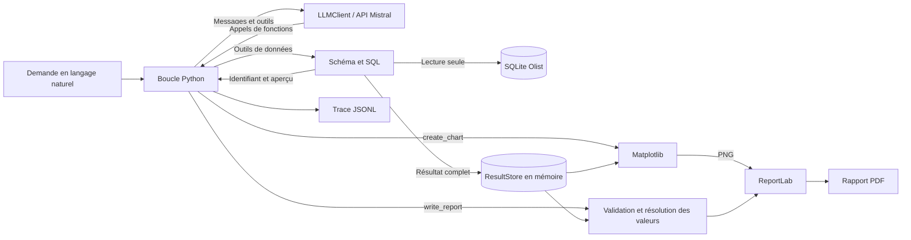

# Agent d’analyse SQL et de génération de rapports PDF

Pose une question sur les commandes Olist. Le projet produit un PDF avec une
synthèse, des tableaux et, si la question s’y prête, des graphiques. Mistral
choisit les requêtes et rédige le rapport. SQLite calcule les chiffres, puis
Python les insère dans le document.

## Le projet en quatre étapes

| Étape | Entrée | Sortie |
| --- | --- | --- |
| **Préparer** | Le ZIP Olist déposé dans `data/raw/` | Une base SQLite et son dictionnaire dans `data/` |
| **Analyser** | Ta question et la base locale | Des résultats SQL en mémoire et des aperçus transmis à Mistral |
| **Produire** | Le brouillon proposé par Mistral et les résultats SQL | Un rapport validé, un PDF et une trace locale |
| **Évaluer** | Les 30 questions de référence et leurs réponses attendues | Un tableau de scores et un fichier JSON par campagne |

Pour suivre un cas concret, lis [le parcours d’une question](#parcours-dune-question).
Pour retrouver les composants dans le dépôt, consulte
[le guide de lecture du code](#guide-de-lecture-du-code).

### Explorer le pipeline dans le navigateur

Ouvre [le studio local](studio/index.html) dans ton navigateur. Au démarrage,
le Studio affiche une exécution Olist de Mistral avec génération du PDF, relecture
visuelle, compteurs de tokens et coûts estimés. Clique une étape du graphe pour lire son
rôle et ses données, ou utilise les contrôles sous « Carte du pipeline » pour
suivre les événements dans l’ordre. L’inspecteur affiche un aperçu et le JSON
de l’événement sélectionné. Sur le nœud **Demande**, l’onglet **Lancement**
permet de copier une commande PowerShell reconstituée à partir de la question
et des paramètres de la trace. `--max-steps` limite les appels au modèle. Chaque
appel peut demander plusieurs outils. Pour le modèle et le juge, **Prompt**
montre les instructions du tour et **À ce tour précis** affiche la requête
et la réponse enregistrées.
Chaque outil a son propre nœud. **Aperçu et gestion du contexte** présente un
exemple de sortie. **Schéma JSON** montre sa définition et **À ce tour précis**
affiche la demande et la réponse de l’appel sélectionné. Le résultat complet
de `run_sql` est conservé dans ResultStore pendant l’analyse.

Le menu liste les traces du dossier `runs/` et permet de revenir à la trace
par défaut. Le projet met à jour le catalogue après chaque exécution. Recharge
le Studio pour voir les nouveaux rapports. Le menu permet aussi d’importer
un fichier seul. Le Studio relit ces traces localement dans le navigateur.

## Générer un rapport

Ouvre un terminal à la racine du projet, dans le dossier qui contient ce README.
Si `data/olist.db` et le fichier `.env` renseigné sont déjà disponibles,
lance directement cette commande.

```powershell
uv run --locked --env-file .env report "Analyse les délais de livraison et leur relation avec les avis en 2017." --out rapport.pdf
```

Le terminal affiche le chemin du PDF et l’identifiant de la trace. Le fichier
`rapport.pdf` apparaît dans le dossier courant. Pour l’ouvrir sous Windows,
utilise `Invoke-Item .\rapport.pdf`.

Ajoute `--review-pdf` pour demander une relecture visuelle après la création
du fichier. La commande envoie à Mistral la question et les images du PDF,
par lots de quatre pages au maximum.
Mistral Large 4 (`mistral-large-4-0`) signale les défauts de mise en page et
propose des corrections, sans modifier le PDF.
`--review-model` permet de choisir un autre modèle multimodal.

Dans le Studio, importe la trace de cette exécution et sélectionne **Juge
visuel** dans la chronologie. L’onglet **À ce tour précis** affiche le lot
examiné et l’avis du juge. Clique sur une vignette pour l’agrandir. Les images
sont conservées dans la trace. Si la relecture échoue, le PDF reste disponible
et l’erreur apparaît dans la trace.

Un exemple généré pendant le développement est disponible dans
`output/pdf/rapport-olist-2017.pdf` sur ce poste. Il compare les avis des
commandes livrées à l’heure ou en avance avec ceux des commandes en retard.
Le modèle par défaut est `mistral-small-2603`. La commande
`uv run --locked report --help` affiche les réglages possibles.

### Première installation sur Linux ou Windows

1. **Prépare la base.** Avec Python 3.11 ou plus récent et `uv`, télécharge
   manuellement le ZIP Olist et dépose-le dans `data/raw/`. Laisse une seule
   archive `.zip` dans ce dossier.
   [Brazilian E-Commerce Public Dataset by Olist](https://www.kaggle.com/datasets/olistbr/brazilian-ecommerce)

   ```powershell
   uv sync --locked
   uv run --locked python scripts/setup_db.py
   ```

   `uv` crée le dossier `.venv` à partir de `uv.lock`. L’import génère
   `data/olist.db` et `data/data_dictionary.md`. La commande `make setup` lance
   le même import si GNU Make est disponible.

2. **Renseigne la clé Mistral.** Si `.env` n’existe pas encore, crée-le avec
   `cp .env.example .env` sous Linux ou `Copy-Item .env.example .env` sous
   PowerShell. Complète la ligne `MISTRAL_API_KEY=` dans ton éditeur. Git
   ignore ce fichier. `--env-file .env` charge la clé pour la commande.

Sur un VPS, utilise `uv sync --locked --no-dev` pour installer les seules
dépendances d’exécution. Ajoute aussi `--no-dev` aux commandes `uv run`
pour garder cet environnement. ReportLab utilise les polices DejaVu fournies
par Matplotlib et génère le PDF directement.

Une fois les dépendances installées, l’import, les tests et la vérification des
références SQL fonctionnent hors ligne. Générer un rapport avec Mistral ou
lancer son benchmark utilise l’API.

### Si une commande échoue

| Message ou symptôme | Étape à vérifier |
| --- | --- |
| PowerShell ne reconnaît pas `uv` | Si `uv` est installé comme module de Python 3.13, remplace `uv` par `py -3.13 -m uv` dans les commandes. |
| Base SQLite absente | Depuis la racine, exécute la commande d’import de l’étape 1 et vérifie que `data/olist.db` a été créé. |
| `MISTRAL_API_KEY` est absente | Vérifie que la ligne dans `.env` contient une valeur et que la commande inclut `--env-file .env`. |

## Parcours d’une question

L’exemple « Délais de livraison et avis en 2017 » part des commandes passées en
2017, livrées, avec une date de livraison et au moins un avis. La requête ramène
les avis à une note par commande, puis compare les commandes livrées à la date
prévue ou avant avec celles arrivées en retard.

| Appel dans la trace | Ce qui passe à l’étape suivante |
| --- | --- |
| `describe_table` | Les colonnes, leurs types et les clés. Le paramètre facultatif `sample_columns` ajoute jusqu’à trois lignes pour les colonnes demandées. |
| `run_sql` | Le résultat `r1` à deux lignes. La colonne `note_moyenne` contient **4,28** pour le premier groupe et **2,32** pour le second. |
| `create_chart` | L’identifiant `c1` du graphique produit localement à partir de `r1`. |
| `write_report` | Le brouillon associe le tableau `r1` et le graphique `c1` à une section et cite les cellules SQL dans le texte. |

Ce tableau illustre les outils disponibles pendant l’analyse. Dans l’exécution
affichée par le Studio, la requête SQL vérifiée figure dans le prompt système.
Mistral l’exécute, crée le graphique et rédige le rapport. Le juge relit ensuite
le PDF.

### Comment une valeur arrive dans le PDF

Pour citer la première note moyenne, le brouillon utilise
`{{r1.note_moyenne[0]}}`.

- `r1` désigne le résultat de la requête.
- `note_moyenne` désigne la colonne.
- `[0]` désigne la première ligne.

Python remplace la référence par `4.28` au moment de la validation. Une
référence à une cellule inexistante provoque une erreur que le modèle peut
corriger. Un nombre écrit en dur et absent des résultats apparaît dans
**Chiffres à vérifier**. Les tableaux et graphiques sont construits à partir du
résultat complet conservé localement, y compris quand l’aperçu donné au modèle
s’arrête après cinq lignes.

## Données et licence

Olist publie son jeu de données brésilien pour la période 2016–2018 sous
**CC BY-NC-SA 4.0**. Cette licence prévoit l’attribution, l’usage non commercial
et le partage des adaptations sous la même licence.
[Fiche Kaggle d’Olist](https://www.kaggle.com/olistbr/brazilian-ecommerce/home/)
· [Licence Creative Commons](https://creativecommons.org/licenses/by-nc-sa/4.0/deed.fr)

L’import charge les neuf CSV UTF-8 avec des types explicites, des dates validées,
des clés et des index de jointure. Il produit `data/olist.db` et
`data/data_dictionary.md`. La vue `products_en` ajoute les traductions de
catégorie disponibles. Le dictionnaire décrit les grains et les pièges observés
dans l’archive, notamment les dates de livraison manquantes et les multiplicités
d’articles, de paiements, d’avis et de points de géolocalisation. Le dossier
`data/` est ignoré par Git.

### À quoi correspond une ligne dans chaque table

| Tables | Une ligne représente |
| --- | --- |
| `orders` | Une commande, avec son statut et ses dates d’achat, d’approbation et de livraison. |
| `customers` | La fiche client liée à la commande. `customer_unique_id` permet de retrouver un acheteur présent sur plusieurs fiches. |
| `order_items` | Un article de commande, lié à un produit et à un vendeur. |
| `order_payments` | Un paiement associé à une commande. Une commande peut avoir plusieurs lignes de paiement. |
| `order_reviews` | Un avis associé à une commande. Une commande peut avoir plusieurs avis. |
| `products`, `sellers`, `category_translation` | Un produit, un vendeur ou une traduction de catégorie. |
| `geolocation` | Un point géographique associé à un préfixe postal, qui peut apparaître plusieurs fois. |

Ce niveau de détail est appelé le **grain**. Une commande avec deux articles et
trois paiements produit six lignes si on joint directement les deux tables sur
`order_id`. Pour totaliser les paiements par commande, on les agrège d’abord
au grain commande. Le [schéma SQL](scripts/olist_schema.sql) décrit les liens
exacts entre les tables.

## Architecture



À chaque tour, la boucle Python envoie les instructions, la question, les
descriptions des outils et l’intégralité des échanges précédents.
Mistral peut demander un outil, par exemple `run_sql` avec une
requête. Python exécute l’outil et renvoie sa réponse avec l’identifiant de
l’appel. Mistral reçoit cette réponse au tour suivant et décide de la suite.
Une colonne inconnue ou une référence invalide peut ainsi être corrigée.
La boucle s’arrête quand `write_report` est validé, quand le nombre maximal
d’appels est atteint ou en cas d’erreur du modèle. Le dernier appel est réservé à
`write_report`. Le prompt demande de finaliser avec les résultats déjà obtenus.
Si aucun rapport valide n’est remis, la CLI renvoie une erreur. La CLI
transmet un rapport validé au moteur PDF.

| Choix | Raison |
| --- | --- |
| `LLMClient` et boucle Python | Tester les appels successifs avec un client scripté et isoler l’adaptateur HTTP Mistral. |
| AST SQLGlot et connexion SQLite en lecture seule | Combiner la validation d’un unique `SELECT` ou `WITH … SELECT`, l’autorisation SQLite et les limites d’exécution. |
| `ResultStore` et aperçu borné | Garder localement les lignes complètes pour les tableaux et graphiques. Le modèle reçoit l’identifiant, les colonnes, les types, le nombre de lignes et jusqu’à cinq exemples. |
| Références numériques | Résoudre `{{r1.total[0]}}` depuis la première ligne de la colonne `total`. Le rapport signale les nombres saisis en dur sans correspondance SQL. |
| Matplotlib et ReportLab | Générer les graphiques PNG, mettre en page le rapport validé et écrire le PDF. |
| Traçage JSONL | Inspecter les messages, les appels d’outils, les latences et les compteurs de tokens. Une grille tarifaire connue fournit une estimation en USD. |

### Guide de lecture du code

| Si tu veux comprendre… | Commence ici |
| --- | --- |
| Comment le ZIP devient une base | [Import des CSV](scripts/setup_db.py), puis [schéma SQLite](scripts/olist_schema.sql). |
| Ce que lance la commande `report` | [CLI](src/sql_report_agent/cli.py), puis `AnalysisAgent.run_report()` dans [la boucle](src/sql_report_agent/agent/loop.py). |
| Comment Python et Mistral dialoguent | [Contrat LLMClient](src/sql_report_agent/llm/base.py) et [adaptateur HTTP Mistral](src/sql_report_agent/llm/mistral.py). |
| Comment un appel d’outil est exécuté | [Outils exposés](src/sql_report_agent/tools/registry.py), [validation SQL](src/sql_report_agent/tools/sql.py) et [stockage des résultats](src/sql_report_agent/store.py). |
| Comment se construit le PDF | [Graphiques](src/sql_report_agent/tools/charts.py), [validation du rapport](src/sql_report_agent/tools/report.py) et [rendu PDF](src/sql_report_agent/render/pdf.py). |
| Comment vérifier le résultat | [Trace et relecture](src/sql_report_agent/tracing.py), puis [calcul des scores](src/sql_report_agent/evaluation.py). |

Le [test de la boucle](tests/test_agent.py) montre quels messages sont envoyés
au modèle et quelles lignes restent dans le `ResultStore`. Les
[tests du rapport](tests/test_report.py) montrent la résolution des références
et l’affichage des chiffres à vérifier. Les
[tests de l’évaluation](tests/test_evaluation.py) montrent comment un résultat
utilisé dans le rapport est comparé à la référence SQL.

## Relire une exécution

Remplacer `RUN_ID` par l’identifiant affiché par la CLI. L’option `--verbose`
affiche les messages du modèle et les sorties d’outils enregistrées.

```sh
uv run --locked replay RUN_ID
uv run --locked replay RUN_ID --verbose
```

Une exécution ordinaire écrit dans `runs/RUN_ID/trace.jsonl`. Les graphiques
éventuels sont dans `runs/RUN_ID/charts/`. Dans la sortie de `replay`, cherche
`run_sql` pour voir les requêtes et leurs aperçus, puis `write_report` pour
retrouver le rapport proposé. Si la trace vient d’un benchmark, le champ
`trace_path` du JSON indique son emplacement. `--runs-dir` permet à `replay`
de retrouver une trace enregistrée dans un dossier personnalisé.

## Évaluation

[Les 30 questions et leurs requêtes](evals/questions.toml) sont accompagnées de
[résultats gelés](evals/expected.json). Quatorze cas incluent une variante naïve.
Par exemple, sur les commandes livrées passées en 2017, les paiements totalisent
**6 922 900,24 BRL**. Une jointure directe avec les articles fait monter le
total à **8 873 231,96 BRL** en répétant les paiements.

### Vérifier les réponses de référence hors ligne

```powershell
uv run --locked python -m sql_report_agent.evaluation --check-references --output runs/eval-references.json
```

Cette commande rejoue les requêtes fournies avec le projet, compare les réponses
à celles enregistrées dans `evals/expected.json` et vérifie que les variantes
naïves produisent bien un résultat différent.

### Mesurer les réponses de Mistral

Lance un cas pour voir le format de sortie, ou les 30 questions pour obtenir
le benchmark complet. Le tableau apparaît dans le terminal et le JSON contient
les résultats par question avec leurs traces.

```powershell
# Une question
uv run --locked --env-file .env python -m sql_report_agent.evaluation --case 15-commandes-total --output runs/eval-un-cas.json

# Les 30 questions
uv run --locked --env-file .env python -m sql_report_agent.evaluation --output runs/eval.json
```

Avec GNU Make et la clé déjà définie dans l’environnement, `make eval` lance
les 30 questions. `make eval EVAL_ARGS="--check-references"` vérifie seulement
les références SQL. `--model` et `--compare-model` comparent deux modèles.
`--price` et `--compare-price` acceptent les tarifs en USD par million de
tokens, entrée puis sortie.

### Comprendre les mesures

- **Exactitude SQL.** Un résultat utilisé dans le texte, un tableau ou un
  graphique du rapport doit correspondre au résultat de référence. Le score est
  calculé **par question**. La comparaison respecte la position des colonnes et
  les doublons. L’ordre des lignes et le nom des colonnes sont libres, et les
  nombres flottants sont comparés à six décimales.
- **Fidélité des chiffres.** Le contrôle est calculé **par occurrence dans le
  texte**. Une valeur insérée par référence, ou écrite directement et présente
  dans un résultat SQL, passe le contrôle. Répéter trois fois une année compte
  pour trois occurrences. La couverture indique combien de rapports présentent
  des chiffres.
- **Ressources.** Le tableau indique le nombre d’appels au modèle, les tokens,
  le coût estimé et le temps jusqu’à la validation du rapport structuré.
  La génération du PDF intervient après cette mesure.

### Résultats vérifiés avec les anciens budgets de contexte

| Exécution | Budget d’entrée | Résultats exacts | Pièges validés | Fidélité | Appels modèle moyens | Latence médiane |
| --- | ---: | ---: | ---: | ---: | ---: | ---: |
| Requêtes de référence sur Olist | — | 30/30 | 14/14 | — | — | — |
| Agent avec client scripté | 12 000 | 30/30 | 14/14 | 100 % | 2 | 53,6 ms |
| Agent avec client scripté | 6 000 | 30/30 | 14/14 | 100 % | 2 | 53,8 ms |
| Agent avec Mistral Small 4 (`mistral-small-2603`) | 12 000 | 28/30 (93,3 %) | 14/14 | 43,6 % | 4,6 | 4,74 s |

Le client scripté rejoue les requêtes de référence pour tester le parcours
complet de l’évaluation. Ses latences mesurent l’exécution locale.

Le benchmark Mistral du 23 novembre 2026 a produit **30 rapports validés**,
consommé **320 196 tokens** et coûté **0,0565 USD estimés**. L’audit a relié
**103 occurrences numériques sur 236** à un résultat SQL. Les années 2017 et
2018 écrites en dur représentent 83 des 133 occurrences signalées. Par exemple,
un tableau peut contenir le bon nombre de commandes et obtenir un verdict SQL
correct. Si le texte répète « en 2017 » et que l’année sert seulement de filtre
dans la requête, chaque mention de 2017 est signalée. C’est ainsi que le score
SQL peut atteindre **93,3 %** et la fidélité du texte **43,6 %** sur la même
exécution.

Les deux écarts SQL portent sur le délai moyen de remise au transporteur
(**2,805** jours au lieu de **2,859**, faute de filtre sur les remises antérieures
à l’approbation) et la période observée (horodatages complets au lieu des jours
au format `YYYY-MM-DD`).

Les sorties locales de ces exécutions se trouvent dans
`runs/eval-references.json`, `runs/eval-scripted.json` et `runs/eval-mistral.json`.

## Limites connues

- La fenêtre de contexte du modèle s’applique à l’historique complet envoyé à
  chaque appel. Le fournisseur fournit ses compteurs effectifs après l’appel.
- Les requêtes ont un délai par défaut de cinq secondes, une limite de
  10 000 lignes et un plafond de volume estimé. Les grandes extractions
  nécessitent une agrégation ou un filtre. Un tableau PDF affiche jusqu’à
  huit colonnes et les 50 premières lignes.
- La vérification numérique contrôle la présence des valeurs et la validité
  des références. L’interprétation, l’unité et la causalité restent à examiner
  dans le rapport. Le coût est une estimation aux tarifs standard, sans
  remise de cache.
- L’évaluation porte sur 30 questions cadrées et sur une archive historique.
  Les scores sont conditionnés par les définitions des cohortes et des
  agrégats formulées dans les questions.

## Vérifier le projet

```sh
uv run --locked ruff check .
uv run --locked ruff format --check .
uv run --locked pytest
```

Les tests couvrent l’import, les bornes SQL, la boucle pilotée par un faux modèle,
l’adaptateur HTTP simulé, les graphiques, le rapport et la comparaison de
configurations. Les tests PDF vérifient le texte, les graphiques, les tableaux
sur plusieurs pages et la numérotation.
